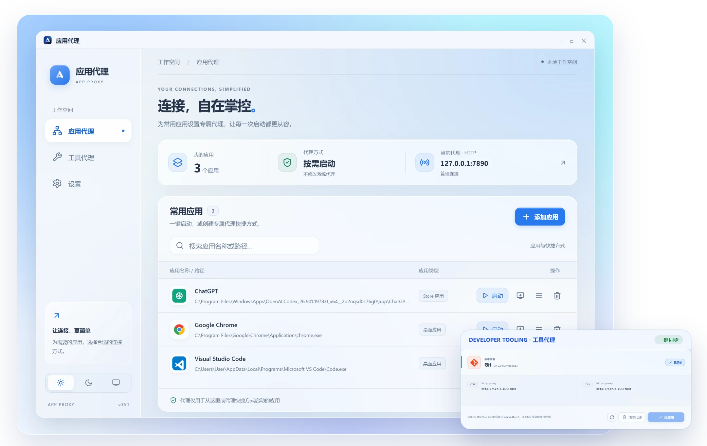

<div align="center">


<h1>应用代理（App Proxy）</h1>

<p>轻量、开源的 Windows 按需应用代理启动器。使用本地 SOCKS / HTTP / HTTPS 代理启动单个应用，不修改系统代理。</p>

<p>
  <strong>简体中文</strong> ·
  <a href="./README_en.md">English</a>
</p>

<p>
  <a href="https://github.com/kolikoliko/app-proxy/releases/latest">
    
  </a>
  <a href="https://github.com/kolikoliko/app-proxy/releases">
    
  </a>
  <a href="https://github.com/kolikoliko/app-proxy/actions/workflows/quality.yml">
    
  </a>
  <a href="./LICENSE">
    
  </a>
  
</p>

<p>
  <a href="#安装">下载安装</a> ·
  <a href="#核心特性">核心特性</a> ·
  <a href="#快速上手">快速上手</a> ·
  <a href="#常见问题">常见问题</a> ·
  <a href="#本地开发">源码构建</a> ·
  <a href="./CHANGELOG.md">更新日志</a>
</p>

<br />

<picture>
  <source media="(prefers-color-scheme: dark)" srcset="docs/images/hero-dark.webp" />
  <source media="(prefers-color-scheme: light)" srcset="docs/images/hero-light.webp" />
  
</picture>

</div>

<br />

## 为什么选择应用代理？

| 方案 | 是否影响全局/国内软件 | 管理员权限 / 虚拟网卡 | 典型适用场景 |
| --- | --- | --- | --- |
| **系统代理** | 会修改全局设置，需维护分流规则 | 不需要 | 全系统浏览器与支持系统代理的软件 |
| **TUN 模式** | 接管整机网卡，可能与企业 VPN/游戏冲突 | 需要管理员权限与驱动 | 需要无感接管全部底层流量的场景 |
| **应用代理（App Proxy）** | **零侵入，完全不改系统代理** | **不需要，纯用户态运行** | 只想让指定应用（浏览器、IDE、ChatGPT、Git）按需走代理 |

## 核心特性

- **按需单应用代理**：仅为目标应用进程树注入代理环境变量，并为 Chrome、Edge、VS Code、ChatGPT 等 Chromium/Electron 应用自动附加代理启动参数，**不修改 Windows 系统代理**。
- **Win32 与 Microsoft Store 全覆盖**：自动扫描已安装的桌面软件与 MSIX/Store 应用，Store 应用支持按应用组自动覆盖包内子组件（如 ChatGPT 与 `codex.exe`）。
- **独立快捷方式启动器**：一键生成带自定义后缀（默认 `-proxy`）的桌面与开始菜单启动器，**关闭主程序后仍可独立使用**；更改代理地址后自动同步已有启动器配置。
- **开发者工具代理**：内置工具代理页，可一键检测、应用或清除 Git 用户级全局代理（SOCKS 自动转为 `socks5h://` 以代理 DNS 查询）。
- **多协议支持与连通性探测**：支持 SOCKS、HTTP、HTTPS 本地代理（默认 `http://127.0.0.1:7890`），内置多地址端口可达性与延迟检测。
- **现代毛玻璃界面与托盘常驻**：支持浅色 / 深色 / 跟随系统外观、6 种主题色、实时搜索、系统托盘左键唤起与快捷启动、开机静默自启，以及基于 GitHub Releases 的签名应用内更新。

## 安装

从 [GitHub Releases](https://github.com/kolikoliko/app-proxy/releases/latest) 下载最新的 Windows x64 安装包：

| 安装包类型 | 文件后缀 | 适用场景 |
| --- | --- | --- |
| **NSIS 安装程序（推荐）** | `*_x64-setup.exe` | 适合大多数个人用户，安装轻快 |
| **MSI 安装包** | `*_x64_zh-CN.msi` | 适合系统管理员或标准化部署 |

> [!NOTE]
> 安装包暂未购买 Authenticode 商业代码签名证书，Windows SmartScreen 可能提示“未知发布者”。请仅从本仓库 Releases 下载并核对校验值。
>
> 从 v0.2.0 起支持应用内检查、验签与安装更新，详见 [应用内更新文档](docs/automatic-updates.md)。

## 快速上手

先启动你的本地代理客户端，并确认 SOCKS、HTTP 或 HTTPS 代理端口可用：

1. **添加应用**：点击「添加应用」，从已安装列表搜索选择程序，或手动浏览 `.exe`。
2. **一键代理启动**：点击应用右侧的 **启动** 按钮，即可使用当前代理启动该应用；若检测到同名后台/窗口进程，启动器会提示确认关闭后重启，确保浏览器等单例进程正确加载代理参数。
3. **创建独立快捷方式**：点击桌面或开始菜单按钮，生成类似 `Chrome-proxy` 的专属快捷方式。此后即便关闭应用代理主程序，也能直接通过快捷方式以代理模式启动。

启动器本身不会修改 Windows、Git 或 npm 的全局代理；如需管理 Git 全局代理，请前往侧边栏的 **工具代理** 页面。

## 常见问题

<details>
<summary><strong>为什么启动浏览器或 Electron 应用时，会提示关闭已有进程？</strong></summary>

Chrome、Edge、VS Code、ChatGPT 等采用单实例架构的应用在后台已有进程时，直接再次启动只会复用旧进程窗口，导致新传入的环境变量和 `--proxy-server` 参数失效。启动器在检测到已有进程时会先征求确认，安全关闭后再以代理模式重新拉起。
</details>

<details>
<summary><strong>在设置里修改代理端口后，以前创建的桌面快捷方式需要重新创建吗？</strong></summary>

不需要。在「设置」中保存新的代理地址后，程序会自动同步更新所有已创建启动器的配置文件与脚本，直接双击原有快捷方式即可生效。
</details>

<details>
<summary><strong>为什么个别软件使用启动器后仍不走代理？</strong></summary>

本工具采用纯用户态环境变量与启动参数注入（不安装虚拟网卡驱动）。如果目标程序自身既忽略 `HTTP_PROXY` / `HTTPS_PROXY` / `ALL_PROXY` 环境变量，又不是 Chromium/Electron 内核且无内置代理参数，这类程序无法通过环境启动器代理。
</details>

## 当前限制

- 仅提供 Windows 10 / 11 x64 构建。
- 本项目不提供节点、订阅或代理服务，需配合本地代理客户端使用。
- 普通 Win32 软件按所选 `.exe` 精确匹配；Microsoft Store/MSIX 应用支持包内应用组。
- 安装包暂未进行商业代码签名。

## 本地开发

环境要求：Node.js 22+、Rust（stable）与 Windows WebView2。

```powershell
# 安装前端依赖
npm install

# 启动 Tauri 桌面开发模式
npm run tauri dev

# 仅启动前端浏览器预览模式
npm run dev

# 运行前后端测试与检查
npm test
cargo test --manifest-path src-tauri/Cargo.toml

# 重新生成 README 双主题展示图（需先构建前端）
npm run build
npm run readme:hero

# 构建 Windows 安装包
npm run tauri build
```

## 参与贡献与安全

- 欢迎提交 Issue 与 Pull Request，参与前请阅读 [贡献指南](CONTRIBUTING.md) 与 [行为准则](CODE_OF_CONDUCT.md)。
- 所有应用规则与配置均仅保存在本机，程序不解密或读取 HTTPS 流量，不上传访问历史。如发现安全隐患，请遵循 [SECURITY.md](SECURITY.md) 私下报告。

## 许可证

本项目基于 [GPL-3.0-or-later](LICENSE) 协议开源。第三方开源组件声明见 [THIRD_PARTY_NOTICES.md](THIRD_PARTY_NOTICES.md)。本项目与任何代理服务或客户端不存在官方隶属关系。
