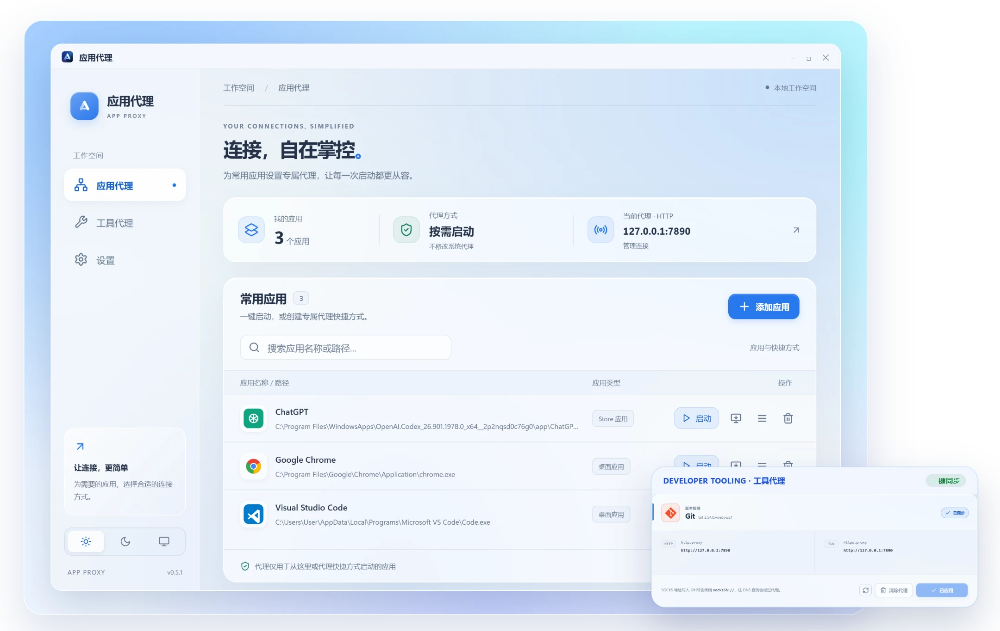

<div align="center">


<h1>App Proxy</h1>

<p>A lightweight, open-source per-application proxy launcher for Windows. Launch individual apps through a local SOCKS, HTTP, or HTTPS proxy without touching system proxy settings.</p>

<p>
  <a href="./README.md">简体中文</a> ·
  <strong>English</strong>
</p>

<p>
  <a href="https://github.com/kolikoliko/app-proxy/releases/latest">
    
  </a>
  <a href="https://github.com/kolikoliko/app-proxy/releases">
    
  </a>
  <a href="https://github.com/kolikoliko/app-proxy/actions/workflows/quality.yml">
    
  </a>
  <a href="./LICENSE">
    
  </a>
  
</p>

<p>
  <a href="#installation">Download</a> ·
  <a href="#features">Features</a> ·
  <a href="#quick-start">Quick Start</a> ·
  <a href="#faq">FAQ</a> ·
  <a href="#build-from-source">Build from Source</a> ·
  <a href="./CHANGELOG.md">Changelog</a>
</p>

<br />

<picture>
  <source media="(prefers-color-scheme: dark)" srcset="docs/images/hero-dark.webp" />
  <source media="(prefers-color-scheme: light)" srcset="docs/images/hero-light.webp" />
  
</picture>

<p><sub>Note: The desktop application UI is currently in Simplified Chinese.</sub></p>

</div>

<br />

## Why App Proxy?

| Approach | Affects Global / Other Apps | Admin Rights / Virtual NIC | Best For |
| --- | --- | --- | --- |
| **System Proxy** | Modifies OS-wide proxy settings | Not required | Routing most browsers and system-proxy-aware apps |
| **TUN Mode** | Captures whole-device traffic; may conflict with VPNs/games | Required (elevated driver) | Transparent capture of all low-level traffic |
| **App Proxy** | **Zero global side effects** | **Not required (pure user-mode)** | Launching specific apps (browsers, IDEs, ChatGPT, Git) through a proxy on demand |

## Features

- **Per-App On-Demand Proxy**: Injects scoped proxy environment variables (`HTTP_PROXY`, `HTTPS_PROXY`, `ALL_PROXY`, `WEBVIEW2_ADDITIONAL_BROWSER_ARGUMENTS`), automatically detects Chromium / Electron / CEF / Squirrel apps (such as Chrome, ChatGPT, and Antigravity) to append standard proxy launch flags, and supports per-app mode toggling (**Auto / Force Flags / Env Only**) — **without modifying Windows system proxy settings**.
- **Win32 & Microsoft Store Support**: Discovers installed desktop programs and MSIX/Store packages automatically, covers multi-component Store package groups (such as ChatGPT and its bundled `codex.exe`), and resolves Squirrel `app-x.y.z` inner executables automatically across updates.
- **Standalone Shortcuts**: Generate Desktop and Start Menu launchers with a customizable suffix (default `-proxy`) that continue working even after App Proxy is closed. Existing launcher configs sync automatically whenever you change the proxy address or launch mode.
- **Developer Tool Proxy**: Inspect, apply, or clear global Git proxy configuration in one click (automatically converts SOCKS URLs to `socks5h://` so DNS lookups also go through the proxy).
- **Multi-Protocol & Connectivity Probe**: Supports local SOCKS, HTTP, and HTTPS proxies (default `http://127.0.0.1:7890`) with built-in IPv4/IPv6 multi-address reachability and latency testing.
- **Minimal Borderless Desktop UI**: Compact `920×620` Linear/Raycast-inspired layout with light, deep charcoal dark, and system themes, 6 accent colors, integrated draggable titlebar, tray quick-launch & left-click restore, silent launch at login, and signed in-app updates via GitHub Releases.

## Installation

Download the latest Windows x64 installer from [GitHub Releases](https://github.com/kolikoliko/app-proxy/releases/latest):

| Package Type | File Pattern | Recommended For |
| --- | --- | --- |
| **NSIS Setup (Recommended)** | `*_x64-setup.exe` | Most desktop users |
| **MSI Installer** | `*_x64_zh-CN.msi` | Managed or enterprise deployments |

> [!NOTE]
> Installers are not signed with a commercial Authenticode certificate yet, so Windows SmartScreen may show an "Unknown publisher" warning. Download only from this repository's official Releases page and verify checksums.
>
> Signed in-app updates are supported starting from v0.2.0. See [Automatic Updates](docs/automatic-updates.md) for details.

## Quick Start

Start your local proxy client first and make sure your SOCKS, HTTP, or HTTPS port is reachable:

1. **Add an Application**: Click **Add App**, search installed Win32 / Microsoft Store apps, or browse for any `.exe` manually.
2. **Launch with Proxy**: Click the **Launch** button to start the app using your configured proxy. If existing background or window processes are detected, the launcher prompts to close and restart them cleanly so single-instance browsers pick up proxy flags.
3. **Create Standalone Launchers**: Click the Desktop or Start Menu shortcut icon to generate a dedicated launcher (e.g., `Chrome-proxy.lnk`). It works independently even when App Proxy is not running.

App launchers never alter global Windows, Git, or npm proxy settings. To manage global Git proxy settings, use the **Tool Proxy** view.

## FAQ

<details>
<summary><strong>Why does the launcher ask to close running instances of a browser or Electron app?</strong></summary>

Single-instance apps such as Chrome, Edge, VS Code, and ChatGPT reuse an already-running background process instead of applying newly passed environment variables or `--proxy-server` flags. Prompting to close existing instances ensures the relaunched process cleanly adopts the proxy configuration.
</details>

<details>
<summary><strong>Do I need to recreate Desktop / Start Menu shortcuts after changing the proxy port?</strong></summary>

No. Whenever you save a new proxy URL in Settings, App Proxy automatically updates all existing launcher configs and scripts in place.
</details>

<details>
<summary><strong>Why doesn't a specific program use the proxy when launched?</strong></summary>

App Proxy runs strictly in user mode without installing a virtual network driver. Programs that ignore standard proxy environment variables and do not accept `--proxy-server` flags (or actively reject `--proxy-server` via built-in security policies, such as the Google Gemini Windows desktop app) cannot be proxied through environment launchers. For unrecognized Chromium / Electron apps, click the mode pill in the app list to switch it to **Force Flags**.
</details>

## Limitations

- Windows 10 / 11 x64 only.
- Does not provide proxy nodes, subscriptions, or proxy server functionality; requires an existing local proxy client.
- Standard Win32 apps match the selected `.exe`; Microsoft Store / MSIX apps cover executables within the package scope.
- Installers are currently unsigned for Authenticode.

## Build from Source

Prerequisites: Node.js 22+, Rust (stable), and Windows WebView2.

```powershell
# Install frontend dependencies
npm install

# Run Tauri desktop app in development mode
npm run tauri dev

# Run browser preview UI only
npm run dev

# Run frontend and Rust test suites
npm test
cargo test --manifest-path src-tauri/Cargo.toml

# Regenerate light & dark README hero mockups (after building frontend)
npm run build
npm run readme:hero

# Build Windows installers
npm run tauri build
```

## Contributing & Security

- Issues and Pull Requests are welcome! Please read the [Contributing Guide](CONTRIBUTING.md) and [Code of Conduct](CODE_OF_CONDUCT.md) first.
- All rules and settings stay strictly local on your machine. App Proxy never inspects HTTPS traffic or collects telemetry. Please report security issues privately via [SECURITY.md](SECURITY.md).

## License

Licensed under [GPL-3.0-or-later](LICENSE). See [THIRD_PARTY_NOTICES.md](THIRD_PARTY_NOTICES.md) for third-party licenses. This project is independent and has no official affiliation with any proxy service or client.
